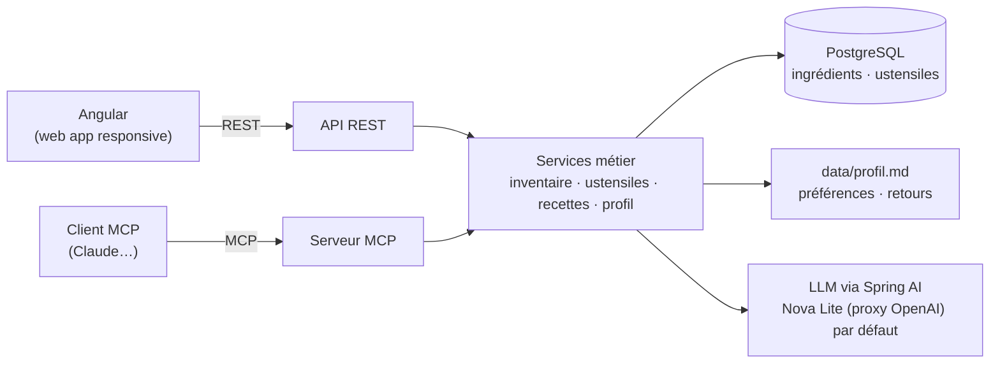

# AntiGaspi 🥕

Application web anti-gaspillage alimentaire : on suit les ingrédients de son frigo et de son garde-manger, on voit d'un coup d'œil ce qui doit être consommé en priorité, et un LLM propose des recettes pour utiliser les produits bientôt périmés.

**Contexte** : projet de formation réalisé à trois. Objectif : une application **minimaliste** qui intègre un **LLM** et un **serveur MCP**.

> Statut : **socle backend** : inventaire statique, profil Markdown génération de recette par LLM au niveau service, et tool LLM `listerIngredients` avec une démo de chat (voir [docs/plans/2026-10-20-socle-inventaire-recette.md](docs/plans/2026-10-20-socle-inventaire-recette.md)).

## Sommaire
- [Fonctionnalités](#fonctionnalités)
- [Stack technique](#stack-technique)
- [Architecture](#architecture)
- [Modèle de données](#modèle-de-données)
- [Structure du repo](#structure-du-repo-cible)
- [Démarrage et configuration](#démarrage-et-configuration)
- [Décisions prises](#décisions-prises) · [Questions ouvertes](#questions-ouvertes)
- [Roadmap](#roadmap)
- [Outillage Claude Code](#outillage-claude-code)
- [Contribuer](#contribuer)

## Fonctionnalités

### 1. Inventaire des ingrédients
Un ingrédient est stocké en base avec :

| Champ | Obligatoire | Remarque |
|---|---|---|
| Nom du produit | oui | |
| Catégorie | oui | légume, fruit, produit laitier… (voir [catégories](#catégories-proposées)) |
| Quantité + unité | oui | ex. `500 g`, `3 pièces` — permet de décrémenter après une recette |
| Date de péremption | **non** | si absente, une **fourchette estimée** est calculée selon la catégorie |
| Date d'ajout | auto | sert à l'estimation et à l'historique |

- **Priorisation** : la liste est triée par urgence de consommation.
- **Indicateurs colorés** plutôt que des dates brutes (UX) — seuils à valider :

  | Couleur | Signification |
  |---|---|
  | 🔴 Rouge | périmé ou à consommer aujourd'hui |
  | 🟠 Orange | ≤ 3 jours |
  | 🟡 Jaune | ≤ 7 jours |
  | 🟢 Vert | > 7 jours |

  Une date **estimée** (pas de date saisie) est signalée comme telle dans l'interface.
- **Modifiable** depuis l'interface **et** via le MCP (ajout, modification, suppression).
- **Évolution** : liste **statique** au départ (données d'amorçage), puis **dynamique** (CRUD complet).
- **Plus tard** (gardé en réserve) : mise à jour par **scan des courses** (code-barres / ticket, ex. Open Food Facts).

### 2. Génération de recettes par LLM
- Un appel API au LLM génère des recettes à partir de la liste, **en priorisant les ingrédients bientôt périmés**.
- Le prompt contient : les ingrédients triés par urgence, les **ustensiles disponibles** (stockés en base) et les **préférences** du profil utilisateur.
- **Modèle** : **Amazon Nova Lite**, appelé via le **proxy compatible OpenAI** de la formation. Le fournisseur reste **interchangeable** : `LLM_BASE_URL` / `LLM_MODEL` dans `.env` pour toute API compatible OpenAI, ou un autre starter Spring AI, sans toucher au code métier.
- Sortie au **format JSON standardisé**, stockable en base plus tard : titre, nombre de personnes, temps de préparation estimé, ustensiles utilisés, ingrédients (nom, poids ou quantité, unité, lien optionnel vers l'aliment du stock) et étapes. Voir [docs/format-recette.md](docs/format-recette.md).

### 3. « J'ai cuisiné cette recette » → mise à jour de la liste
Après avoir réalisé une recette, un **écran de confirmation** liste les ingrédients utilisés avec les quantités **préremplies et modifiables** (si la recette a été adaptée). À la validation, les quantités sont décrémentées et les ingrédients épuisés sont supprimés.

### 4. Profil utilisateur (`.md`) et feedback
Chaque utilisateur a un fichier Markdown de profil (préférences alimentaires, historique des retours), lu par le LLM à chaque génération. Il est **modifiable par l'utilisateur** (interface et MCP).

> Les **ustensiles disponibles** ne sont **pas** dans le profil : ils sont stockés en base (table `utensil`, fichier JSON statique pour l'instant), modifiables par l'utilisateur, par exemple en cas de déménagement ou d'appareil cassé.

```markdown
# Profil

## Préférences
- N'aime pas les plats épicés
- Végétarien le midi

## Historique des retours
- 2026-10-19 · Curry de légumes · 👎 · « trop épicé »
```

**Boucle de feedback** :
1. Après une recette, l'utilisateur donne un retour : appréciée ou non, bonne idée ou non, commentaire libre.
2. Le retour brut est ajouté à la section **Historique des retours**.
3. Le LLM **consolide** la section **Préférences** (synthèse courte, sans doublons ni contradictions).

> Le feedback n'est **pas** stocké en base : le `.md` suffit.

### 5. Serveur MCP
Un serveur [MCP (Model Context Protocol)](https://modelcontextprotocol.io) intégré au backend expose les fonctionnalités de l'application à un assistant compatible (Claude Desktop, Claude Code…). Il réutilise les mêmes services métier que l'API REST.

Tools proposés :

| Tool | Rôle |
|---|---|
| `list_ingredients` | lister l'inventaire, trié par urgence |
| `get_expiring_ingredients` | ingrédients à consommer sous N jours |
| `add_ingredient` / `update_ingredient` / `remove_ingredient` | gérer la liste |
| `consume_ingredients` | retirer / décrémenter les ingrédients utilisés par une recette |
| `get_profile` | lire le profil (préférences) |
| `update_preferences` | modifier les préférences du profil |
| `list_utensils` / `add_utensil` / `remove_utensil` | gérer les ustensiles disponibles |
| `add_feedback` | enregistrer un retour sur une recette |
| `generate_recipe` | générer une recette via le LLM de l'application |

Deux usages possibles : Claude appelle `generate_recipe` (génération par le LLM de l'appli), **ou** génère lui-même la recette à partir de `list_ingredients` + `list_utensils` + `get_profile`, puis met la liste à jour avec `consume_ingredients`.

### 6. Interface utilisateur
- **Web app Angular**, minimaliste et **responsive (mobile-first)** : elle doit fonctionner correctement sur ordinateur et sur téléphone.
- Trois écrans : **Inventaire**, **Recettes**, **Profil**.
- Design à valider avec le maquettage : voir [docs/maquettes/](docs/maquettes/).

## Stack technique

Versions **proposées**, à confirmer à l'initialisation du code.

| Couche | Choix |
|---|---|
| Backend | Java 21, Spring Boot 4, Spring AI 2, Maven |
| Frontend | Angular (web app responsive) |
| Base de données | PostgreSQL (docker-compose en dev), H2 en mémoire pour les tests, migrations Flyway |
| LLM | Spring AI `ChatClient` (starter OpenAI) — Nova Lite via le proxy compatible OpenAI de la formation |
| MCP | Spring AI MCP Server, intégré au backend |
| Profil utilisateur | fichier `data/profil.md` (gitignoré ; un gabarit sera versionné) |

## Architecture



Le backend isole le LLM derrière une interface métier (ex. `RecipeGenerator`) : changer de fournisseur ne touche que la configuration.

## Modèle de données

Table `ingredient` (proposition) :

| Colonne | Type | Contrainte |
|---|---|---|
| `id` | `bigint` | PK |
| `name` | `varchar` | non nul |
| `category` | `varchar` (enum) | non nul |
| `quantity` | `numeric` | non nul, > 0 |
| `unit` | `varchar` (enum) | non nul (`g`, `kg`, `ml`, `l`, `pièce`…) |
| `expiry_date` | `date` | **nullable** |
| `added_at` | `timestamp` | non nul, par défaut maintenant |

Table `utensil` (ustensiles disponibles) :

| Colonne | Type | Contrainte |
|---|---|---|
| `id` | `bigint` | PK |
| `name` | `varchar` | non nul, unique |

Les recettes générées pourront être stockées à partir de leur [format JSON standardisé](docs/format-recette.md), qui propose aussi un schéma de tables.

> Pour l'instant, ingrédients et ustensiles sont des fichiers JSON statiques (`backend/src/main/resources/data/`), derrière les interfaces `IngredientRepository` et `UtensilRepository`.

### Catégories proposées
Fruits, légumes, produits laitiers, viandes & poissons, œufs, féculents, épicerie sèche, conserves, surgelés, boissons, condiments.

Chaque catégorie a une **durée de conservation par défaut** (fourchette min/max en jours), utilisée quand `expiry_date` est vide. Valeurs à définir.

## Structure du repo (cible)

```
AntiGaspi/
├── pom.xml              # POM agrégateur — nécessaire pour les hooks Maven
├── backend/             # Spring Boot : services métier par fonctionnalité (ingredient, utensil, profile, recipe), puis API REST et serveur MCP — voir CLAUDE.md
├── frontend/            # Angular (à créer)
├── data/                # profil.md (gitignoré) + gabarit profil.example.md
├── docs/
│   └── maquettes/       # maquettes / wireframes
├── Dockerfile           # image du backend (build Maven + JRE 21), aucun Java requis sur l'hôte
├── docker-compose.yml   # service backend (PostgreSQL à ajouter)
├── .env.example         # gabarit des variables d'environnement
└── .claude/             # config Claude Code partagée (agents, skills, hooks, permissions)
```

## Démarrage et configuration


```bash
git clone git@github.com:emocio-tech/AntiGaspi.git
cd AntiGaspi
cp .env.example .env   # puis renseigner LLM_BASE_URL, LLM_API_KEY (une seule ligne chacune)
cp data/profil.example.md data/profil.md   # puis adapter les préférences
```

**Avec Java 21 et Maven** :

```bash
mvn verify                                                        # build + tests (sans appel LLM)
mvn -pl backend spring-boot:run -Dspring-boot.run.profiles=demo   # démo : 10 recettes générées dans le terminal + bilan des échecs
mvn -pl backend spring-boot:run -Dspring-boot.run.profiles=chat   # chat : le LLM consulte l'inventaire par son tool (« quitter » pour sortir)
```

**Sans Java, avec Docker** (seul Docker Desktop ou Docker Engine + Compose est nécessaire) :

```bash
docker compose build              # compile et lance les tests dans l'image (première fois : quelques minutes)
docker compose run --rm backend   # démo : aliments urgents + 10 recettes générées + bilan, puis arrêt
SPRING_PROFILES_ACTIVE=chat docker compose run --rm backend   # chat avec le LLM, qui consulte l'inventaire par son tool
```

- Le `.env` est passé au conteneur au lancement (`env_file`), il n'est **jamais** copié dans l'image (`.dockerignore`).
- Le dossier `data/` est monté en lecture seule : `data/profil.md` est pris en compte sans reconstruire l'image.
- Après une modification du code, relancer `docker compose build`. Pour aller plus vite : `docker compose build --build-arg SKIP_TESTS=true`.

Toutes les variables sont décrites dans [.env.example](.env.example) : fournisseur et modèle LLM, clé API, base de données, chemin du profil.

> **🔒 Secrets**
> - La clé API LLM vit **uniquement** dans `.env`, qui n'est jamais commité.
> - **Claude Code n'a pas le droit de lire `.env`** : des règles `deny` sont définies dans [.claude/settings.json](.claude/settings.json). Elles bloquent ses outils de lecture et les commandes comme `cat`, mais pas un script qui ouvrirait le fichier lui-même.
> - Pour une protection au niveau de l'OS, activer le sandbox Claude Code (`/sandbox`). Il fonctionne sur Linux, macOS et WSL2 et nécessite `bubblewrap` et `socat` ; il n'existe pas sous Windows natif.
> - Le backend chargera `.env` via `spring.config.import=optional:file:.env[.properties]`.

## Décisions prises

| Sujet | Décision | Date |
|---|---|---|
| Stack | Java (Spring Boot, Maven) + Angular, web app responsive | 2026-10-19 |
| Base de données | PostgreSQL pour les ingrédients et les ustensiles (les recettes plus tard) | 2026-10-20 |
| Feedback | pas de table : enrichit le profil `.md`, consolidé par le LLM | 2026-10-19 |
| Utilisateurs | mono-utilisateur pour le MVP, pas d'authentification | 2026-10-19 |
| LLM | Nova Lite via le proxy compatible OpenAI de la formation (accès direct à Bedrock abandonné), fournisseur interchangeable par configuration | 2026-10-20 |
| Ingrédient | nom, catégorie, quantité + unité, péremption optionnelle (estimée sinon), date d'ajout | 2026-10-19 |
| Urgence | indicateurs colorés plutôt que dates brutes | 2026-10-19 |
| Consommation | écran de confirmation avec quantités modifiables | 2026-10-19 |
| Ustensiles | stockés en base (JSON statique en attendant), plus dans le profil `.md` | 2026-10-20 |
| Format de recette | JSON standardisé à clés anglaises, quantité = nombre + unité, `ingredientId` optionnel ([docs/format-recette.md](docs/format-recette.md)) | 2026-10-20 |
| Secrets | clé API dans `.env`, lecture interdite à Claude Code | 2026-10-19 |
| Méthode | TDD obligatoire : tests écrits avant le code (voir [CLAUDE.md](CLAUDE.md)) | 2026-10-20 |
| Versions | Spring Boot 4.1 / Spring AI 2.0 (Spring Boot 3 n'est plus proposé par Spring Initializr) | 2026-10-20 |
| Données de test | inventaire statique JSON en jours relatifs, en attendant PostgreSQL | 2026-10-20 |

## Questions ouvertes

- [ ] Durées de conservation par défaut de chaque catégorie, et seuils exacts des couleurs.
- [ ] Unités gérées et conversions (`g` ↔ `kg`, pièces…).
- [ ] « Placard de base » (sel, poivre, huile…) : considéré comme toujours disponible, sans être listé ?
- [ ] Paramètres de génération : nombre de personnes, temps maximal, nombre de recettes proposées.
- [ ] Faut-il garder un historique ou des favoris de recettes ?
- [ ] Quotas et coût du proxy Nova Lite ; partage de la clé à trois.
- [ ] Usage local uniquement, ou hébergement ?
- [ ] Sécurité du serveur MCP (accès local seulement ? jeton ?).
- [ ] Écritures concurrentes du profil `.md` (interface + MCP en même temps).
- [x] Stratégie de tests : TDD, tests unitaires avec LLM simulé ; vérification en réel avec la démo terminal.

## Roadmap

1. **Socle** — POM parent, backend Spring Boot, PostgreSQL (docker-compose), table `ingredient`, données d'amorçage
2. **Inventaire** — API REST + écran Inventaire (tri par urgence, couleurs, estimation de péremption)
3. **Recettes** — appel LLM (Nova Lite) via Spring AI, affichage structuré
4. **Profil & feedback** — `profil.md`, écran Profil (préférences, ustensiles), boucle de feedback
5. **Consommation** — écran « J'ai cuisiné cette recette », mise à jour de la liste
6. **MCP** — serveur MCP et ses tools
7. **UI** — finitions responsive d'après les maquettes
8. **Bonus** — scan des courses, PWA, notifications avant péremption

## Outillage Claude Code

Le dossier [.claude/](.claude/) contient la config partagée : agents, skills, commandes, hooks et permissions.

Les hooks passent par [.claude/hooks/run-hook.sh](.claude/hooks/run-hook.sh), qui choisit le script selon l'OS :
- **Windows** (Git Bash) → `<hook>.ps1` (PowerShell) ;
- **Linux / macOS / WSL** → `<hook>.sh` (bash, nécessite `jq`, `python3` ou `node` pour lire le JSON).

Un hook sans script pour l'OS courant ne fait rien. Les hooks actuels (lint + tests avant commit/push, tests en fin de tour) ne s'activent que dans un projet Maven, et cherchent le `pom.xml` **à la racine** du répertoire de travail : d'où le POM parent prévu à la racine, avec `backend` comme module. Avec le backend Java, les commandes `/javadoc` et `/review-avant-commit` deviennent utiles.

## Contribuer

- Branche par fonctionnalité : `feat/<nom>`, `fix/<nom>`
- Pull request vers `main`
- Ne jamais commiter `.env`, une clé API ou `data/profil.md`
